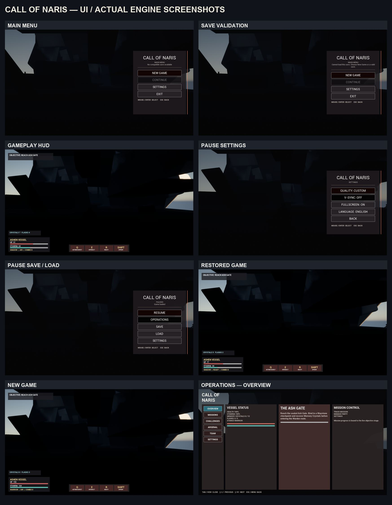
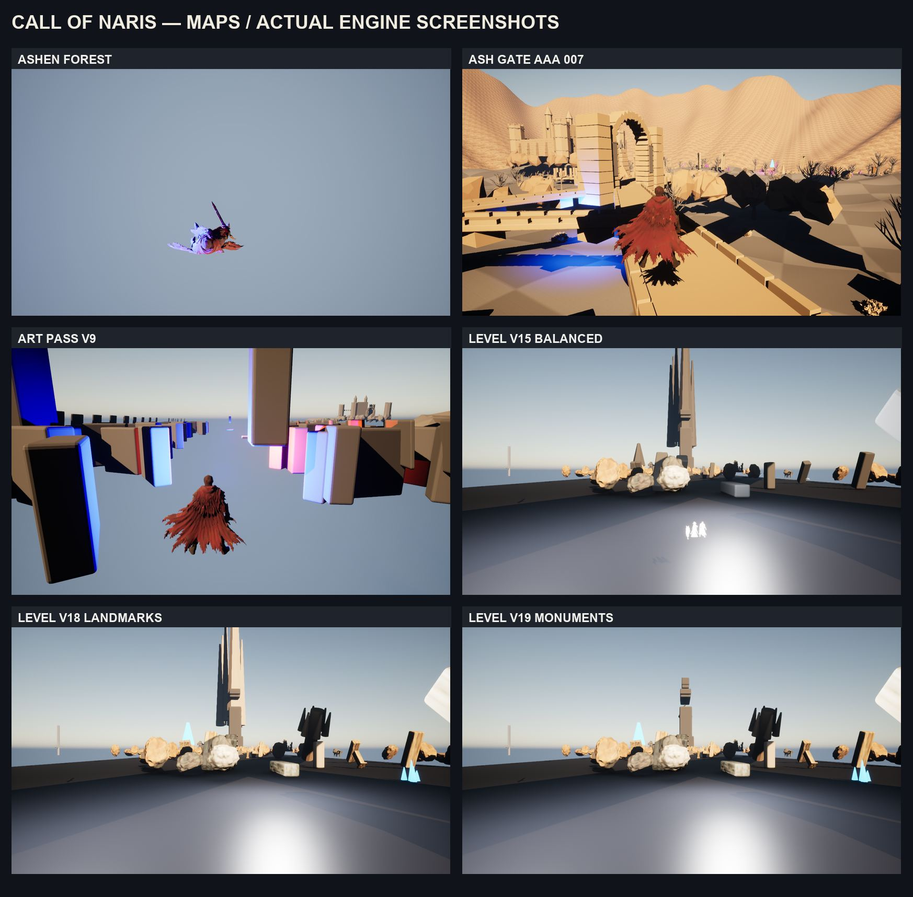

# CALL OF NARIS — Real Unreal Engine Screenshots (22 Nov 2026)

هذه الصور ناتجة مباشرة من Unreal Engine 5.7.4 على AsusRog، وليست تصاميم أو توليد صور. تشمل لقطات Windows Development الفعلية ومشاهد مراجعة الخرائط. لم تُعتمد هذه الخرائط للإصدار النهائي، ولم يُغيَّر main أثناء إعداد المعرض.

**UI:** 44/44 UI Flow checks passed (temporary save fixtures removed); UI capture includes Main Menu, invalid save, gameplay HUD, pause settings, pause save/load, restored gameplay, new game, and Operations Overview. **Operations** has additional tabs Missions, Challenges, Arsenal, Team, Settings visible in Overview; individual tab screenshots are not yet included.

**Art review:** The actual gameplay spawn camera is obstructed by dark scene geometry. Ashen Forest showcase appears visually incomplete (character/background only). Ash Gate AAA 007 has more scene content. V15/V18/V19 are development map variants; V19 mitigates exaggerated pillars but still has blockout-level visuals and requires visual QA.

## UI contact sheet

## Map contact sheet

## Original-resolution inspectable JPGs

### Interfaces
- [Main Menu](screens/ui-main-menu.jpg)
- [Invalid Save Validation](screens/ui-invalid-save.jpg)
- [Gameplay HUD](screens/ui-gameplay-hud.jpg)
- [Pause / Settings](screens/ui-pause-settings.jpg)
- [Pause / Save / Load](screens/ui-pause-save-load.jpg)
- [Restored Gameplay](screens/ui-restored-game.jpg)
- [New Game](screens/ui-new-game.jpg)
- [Operations Overview](screens/ui-operations-overview.jpg)

### Maps
- [Ashen Forest Showcase V3](screens/map-ashen-forest.jpg)
- [Ash Gate AAA Slice 007](screens/map-ash-gate.jpg)
- [Art Pass V9](screens/map-art-pass-v9.jpg)
- [Level V15 Balanced](screens/map-level-v15.jpg)
- [Level V18 Landmarks](screens/map-level-v18.jpg)
- [Level V19 Monuments](screens/map-level-v19.jpg)

**Provenance:** `Gallery_20261122/UIFlow/ui-flow-receipt.json` and logs are stored on the user's AsusRog. Each image here corresponds to a captured local Unreal frame. This media-only review branch is not a PR, feature merge, production release, or proof of stable FPS.

